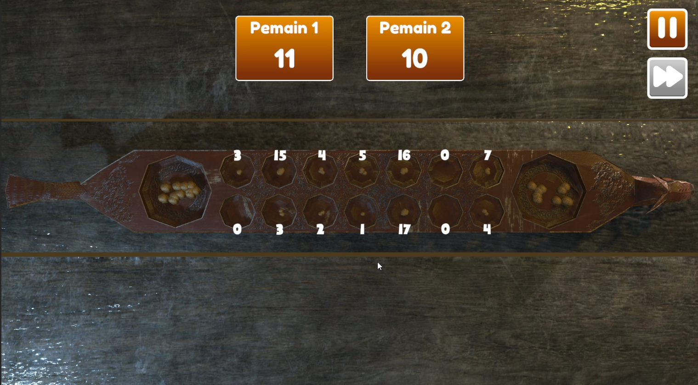

# The Congklak

Adaptasi digital permainan tradisional Indonesia, Congklak, untuk PC. Dibuat dengan Unity dan C# sebagai playable prototype untuk portofolio game programmer.

## ▶ Main Sekarang (Windows)

**[Unduh The Congklak v0.1.0 (Windows)]
(https://github.com/MYR99/TheCongklak/releases/tag/v0.1.0)

1. Unduh `TheCongklak_v0.1.0_Windows.zip` dari halaman Release.
2. Ekstrak zip (jangan dijalankan dari dalam zip).
3. Jalankan `The Congklak.exe`.

Jika muncul peringatan Windows SmartScreen ("Windows protected your PC"), klik **More info → Run anyway**. Peringatan ini muncul karena aplikasi belum ditandatangani secara digital.

▶ [Video demo gameplay]
(https://drive.google.com/file/d/1ZtBy0yrnjELMgVhodrqHJnSRJoG6ZYHO/view?usp=drive_link)

## Cara Bermain

**Kontrol:** klik lubang di sisimu dengan mouse untuk menyebar biji. Tombol pause dan fast-forward ada di pojok kanan atas.

**Ringkasan aturan** (sesuai implementasi di game ini):

- Papan terdiri dari 7 lubang per pemain dan 1 lumbung per pemain. Setiap lubang diisi 7 biji di awal.
- Biji disebar satu per lubang secara berurutan. Lumbung lawan dilewati.
- Biji terakhir jatuh di **lumbungmu sendiri**: kamu mendapat giliran tambahan (*extra turn*).
- Biji terakhir jatuh di **lubang kosong di sisimu**: kamu menembak (*capture*), dan biji di lubang seberang beserta biji terakhir itu masuk ke lumbungmu.
- Biji terakhir jatuh di **lubang yang sudah berisi**: penyebaran dilanjutkan dari lubang itu (*sow continue*).
- Permainan berakhir ketika deretan lubang kecil dari salah satu sisi kehabisan biji. Dan skor akhir dihitung dari banyaknya biji di lumbung/lubang besar milik pemain.

Tutorial di dalam game menjelaskan extra turn, capture, dan sow continue saat pertama kali terjadi.

## Fitur

- Mode **Player vs Player** dan **Player vs AI**
- AI dengan tiga tingkat kesulitan (Easy, Medium, Hard)
- Aturan inti: penyebaran biji, skor lumbung, validasi langkah, extra turn, capture, deteksi lubang kosong, sow continue
- Tutorial kontekstual (pengenalan awal serta tips extra turn, capture, dan sow continue)
- Dua bahasa: Indonesia dan English
- Skor real-time, indikator giliran, dialog modal, pause, dan fast-forward
- Tema budaya: antarmuka bergaya Indonesia dan papan congklak tradisional

## Cara Kerja AI

Tingkat kesulitan dibedakan oleh seberapa sering AI memilih langkah acak:

| Tingkat | Langkah acak | Logika yang dipakai selain acak |
|---|---|---|
| Easy | 90% | Logika Medium |
| Medium | 50% | Logika Medium |
| Hard | 40% | Logika Hard |

- **Logika Medium:** mencari lubang yang membuat biji terakhir jatuh di lumbung (extra turn). Cek dilakukan dengan aritmetika modular: jumlah biji dibagi jumlah lubang dalam satu putaran, dibandingkan dengan jarak lubang ke lumbung.
- **Logika Hard:** mengutamakan extra turn. Jika tidak ada, AI mensimulasikan lubang pendaratan setiap langkah dan memilih langkah dengan capture terbesar.

Kode lengkapnya: [AIController.cs](https://github.com/MYR99/TheCongklak/blob/main/Assets/Scripts/Controller/AIController.cs)

## Teknologi

- Unity 2022.3.62f2 dan C#
- TextMeshPro untuk teks UI
- ScriptableObject (`GameConfig`) untuk pengaturan game
- Object pooling (`SeedPool`) untuk biji

## Struktur Proyek

Kode berada di `Assets/Scripts/` dengan sub-folder `Board State`, `Controller`, `Core`, dan `Localization`. Skrip utama:

- `GameManager`: alur giliran, penyebaran biji, skor, dan akhir permainan
- `Hole`: lubang dan lumbung beserta bijinya
- `AIController`: pemilihan langkah AI
- `SeedPool`: object pool untuk biji
- `GameConfig`: pengaturan game (ScriptableObject)
- `PlayerInputController`: input klik pemain

## Batasan yang Diketahui

- AI hanya mengevaluasi satu langkah ke depan dan belum mensimulasikan penyebaran lanjutan (*relay sowing*). Tingkat kesulitan dibedakan oleh rasio langkah acak, bukan kedalaman pencarian.
- Logika aturan masih bercampur dengan UI, audio, dan tutorial di `GameManager`, sehingga sulit diuji otomatis.
- Klik pada lubang tertangani oleh dua jalur input (`Hole.OnMouseDown` dan `PlayerInputController`).
- Hanya tersedia build Windows 64-bit.
- Aplikasi belum ditandatangani, sehingga memicu peringatan SmartScreen.

## Rencana Pengembangan

1. Memisahkan logika aturan dari MonoBehaviour dan menambahkan unit test
2. AI yang mensimulasikan relay sowing
3. Build WebGL

## Kredit dan Aset

- Kode dan desain sistem: Fahry Ammar ([@MYR99](https://github.com/MYR99))

## Kontak

GitHub: [@MYR99](https://github.com/MYR99)
